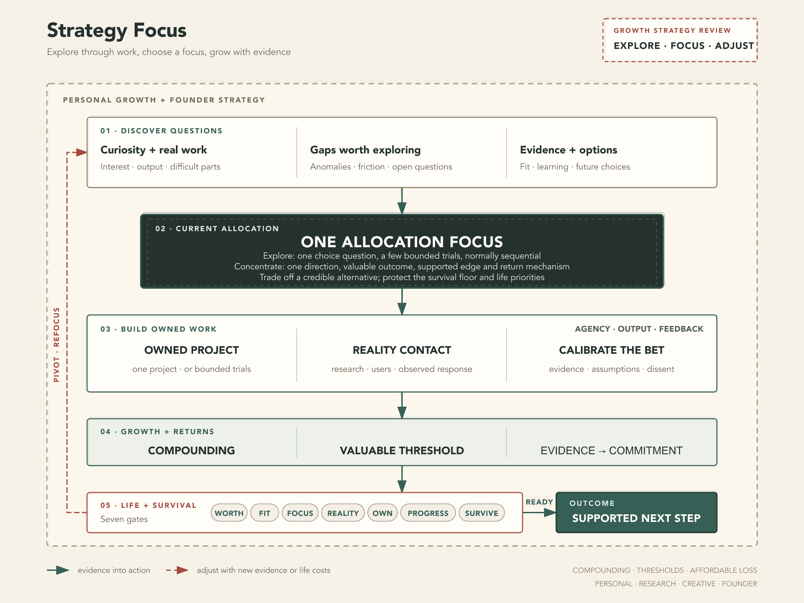

# Formulate Strategy

An Agent Skill for Codex, Claude Code, and Cursor that helps you discover worthwhile problems, explore uncertain directions through real work, and choose the research, creative project, or startup worth concentrating on.

> **Explore through work, choose a focus, grow with evidence.**

## Architecture



The skill moves from worthwhile questions to actual work, calibrated judgment, concentrated resources, and continued growth. When evidence is thin, one **Provisional Exploration Focus** can compare a few projects across fields, normally tried sequentially within a resource boundary. When a direction is supported, one **Current Growth Focus** governs resource allocation.

Owned work produces agency and feedback. The **Growth and Return Mechanism** distinguishes compounding, crossing a valuable threshold, and combinations of the two. Evidence determines whether to increase, maintain, or reduce commitment; success costs and the survival floor constrain the choice.

## Origins

Paul Graham's essays remain the primary lens: finding questions, exploring through work, independent judgment, owned projects, returns, early users, and founder survival. Sam Altman's interview with Raj Shamani adds practitioner examples of evidence-based commitment, progressively harder challenges, and the costs of success. Independent safeguards cover strategic focus, affordable loss, staged validation, and the outside view. These are operational interpretations, not a universal success formula; see the [research provenance](formulate-strategy/references/research-provenance.md).

## Install

Clone once:

```bash
git clone https://github.com/ZepinLi/formulate-strategy.git
cd formulate-strategy
```

Link the same skill into any client you use:

```bash
# Codex
mkdir -p ~/.codex/skills
ln -s "$PWD/formulate-strategy" ~/.codex/skills/formulate-strategy

# Claude Code
mkdir -p ~/.claude/skills
ln -s "$PWD/formulate-strategy" ~/.claude/skills/formulate-strategy

# Cursor
mkdir -p ~/.cursor/skills
ln -s "$PWD/formulate-strategy" ~/.cursor/skills/formulate-strategy
```

Restart the client or open a new agent session if the skill is not discovered immediately. Cursor users can alternatively [import the GitHub repository](https://cursor.com/docs/skills#installing-skills-from-github) from **Customize → Rules → Add Rule → Remote Rule (GitHub)**.

## Use

| Client | Direct invocation |
| --- | --- |
| Codex | `$formulate-strategy help me choose the work worth concentrating on now.` |
| Claude Code | `/formulate-strategy help me choose the work worth concentrating on now.` |
| Cursor | `/formulate-strategy help me choose the work worth concentrating on now.` |

All three clients may also discover the skill automatically from its description. The language default is English, with another language used when requested or clearly preferred.

A complete strategy normally groups the focus, evidence, alternatives, owned work and returns, and commitments into five compact parts. An explicitly requested full report expands to eight sections. A local question or brief critique gets a direct answer; missing information prompts at most three consequential questions per turn.

Example requests:

- "I haven't tried research, technical writing, or building a tool. Help me learn which to pursue within six weekends."
- "Is this theorem worth four months of focused work, even if the result is a one-time breakthrough?"
- "Our prototype has stronger evidence. What would justify the next increase in my commitment?"
- "Critique this direction in three sentences."

## Structure

```text
formulate-strategy/
├── README.md
├── LICENSE
├── assets/
│   ├── strategy-focus-review-canvas.png
│   └── strategy-focus-review-canvas.svg
├── evals/
│   ├── cases.json
│   ├── responses/
│   │   ├── baseline.md
│   │   └── candidate.md
│   └── results-2026-11-07.md
└── formulate-strategy/
    ├── SKILL.md
    ├── references/
    │   ├── decision-calibration.md
    │   ├── founder-growth.md
    │   └── research-provenance.md
    └── agents/
        └── openai.yaml
```

The inner `formulate-strategy/` directory is the self-contained skill. Decision calibration and founder guidance load only when relevant; provenance loads for source or methodology requests. The skill has no dependency on local transcripts or the repository's evaluation artifacts.

## Behavioral evaluation

[Evaluation cases](evals/cases.json) contain reusable requests and behavior-level acceptance criteria. Test each request as a fresh conversation with the skill and only its relevant references, without supplying the criteria to the responding agent. Compare actual responses against the criteria; headings or keyword matches are not a substitute. See [the latest comparison](evals/results-2026-11-07.md) for the baseline, procedure, observations, and limitations.

## License

[MIT](LICENSE)
