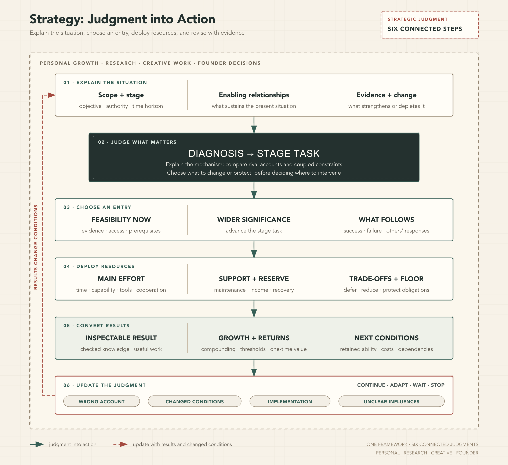

# Formulate Strategy

A skill for **Codex, Claude Code, and Cursor**. Decide where to act, what to commit, and when to revise in your career, research, creative work, or early startup.



## Quick start

```bash
git clone https://github.com/ZepinLi/formulate-strategy.git
cd formulate-strategy

skill_client=.codex  # Or .claude or .cursor
skill_dir="$HOME/$skill_client/skills"
mkdir -p "$skill_dir" && ln -s "$PWD/formulate-strategy" "$skill_dir/formulate-strategy"
```

| Client | Invoke with |
| --- | --- |
| Codex | `$formulate-strategy` |
| Claude Code or Cursor | `/formulate-strategy` |

Add your question after the skill name. Start a new session if the client doesn’t discover it.

If Codex on Linux reports `bwrap: ... Operation not permitted`, see the [reference-loading notes](evals/reference-loading-2026-11-16.md) and [setup helper](scripts/codex-allow-reads.sh).

## Docs

[Skill](formulate-strategy/SKILL.md) · [References](formulate-strategy/references/) · [Evaluation](evals/results-2026-11-16.md) · [MIT License](LICENSE)
